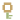
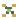
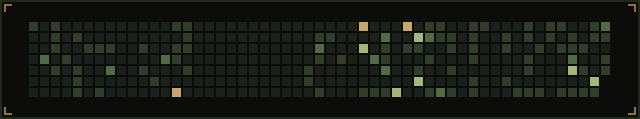

  
   
  
   
  Exploring technology for a more private, open and sovereign world.
   
  

<h3></h3>

Software should expand what a person can do on their own. It should not quietly rent them their own life.

 &nbsp;**Ownership** · your keys, your files, your identity 
 &nbsp;**Privacy** · the default, not a setting 
 &nbsp;**Openness** · code anyone can read, fork and fix 
 &nbsp;**Autonomy** · fewer middlemen between you and what you made

<h3></h3>

Things I built because they should exist.

 &nbsp;**[Nota](https://github.com/vellbenev/Nota)** &nbsp;★ 18 · TypeScript · local-first 
Read academic papers without distraction, with on-demand local AI. Nothing leaves your machine.

 &nbsp;**[proxy-aggregator](https://github.com/vellbenev/proxy-aggregator)** &nbsp;TypeScript · [live](https://proxy-aggregator-web.vercel.app) 
A directory of MTProto proxies, kept fresh by an automated scraper.

 &nbsp;**[TONForensics](https://github.com/vellbenev/TONForensics)** &nbsp;TypeScript · on-chain 
Intelligence console for TON: profile wallets and trace token flows.

 &nbsp;**[url-to-md](https://github.com/vellbenev/url-to-md)** &nbsp;Python · Flask 
Paste a URL, get clean Markdown.

<h3></h3>

 &nbsp;**Unchain Foundation** &nbsp;in progress

Tools that let people hold their own money, identity and data, without asking anyone's permission.

Privacy-preserving systems · peer-to-peer infrastructure · zero-knowledge technology

<h3></h3>

Zero-Knowledge Proofs · Cryptography & Privacy Engineering · Blockchain & Decentralized Systems · Self-Sovereign Infrastructure · Open-source Software

<h3></h3>

  
   
  Every square is a day.
    
  

