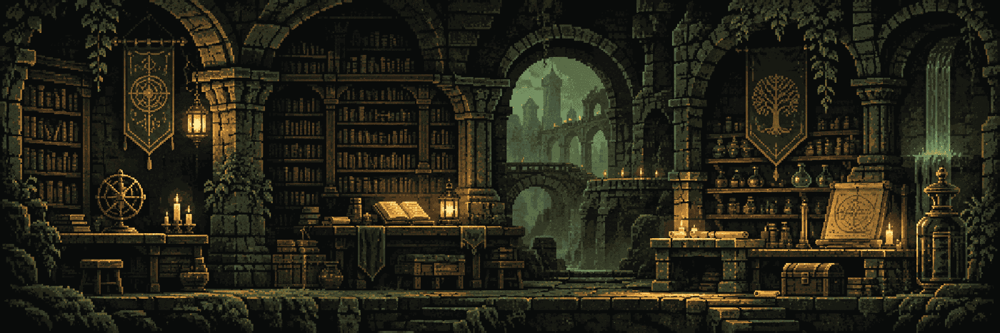

  

 

<table>
  <tr>
    <td width="170" align="center" valign="middle">
      
    </td>
    <td valign="middle">
      <h3>VELLBENEV</h3>
      
Builder · Independent Thinker · Technology Explorer

      
<b>I build things I wish existed.</b> 
      Exploring technology for a more private, open and sovereign world.

      

        
        <code>now: Unchain Foundation</code>
      

    </td>
  </tr>
</table>

  

###  &nbsp;01 · THE CODEX

Software should expand what a person can do on their own. It should not quietly rent them their own life.

| Value | In practice |
| :-- | :-- |
| **Ownership** | your keys, your files, your identity |
| **Privacy** | the default, not a setting |
| **Openness** | code anyone can read, fork and fix |
| **Autonomy** | fewer middlemen between you and what you made |

  

###  &nbsp;02 · THE WORKSHOP

Tools I needed and could not find, so I built them.

| Project | What it is |
| :-- | :-- |
| **[Nota](https://github.com/vellbenev/Nota)** ★ | Read academic papers without distraction. Local-first, with on-demand local AI. |
| **[proxy-aggregator](https://github.com/vellbenev/proxy-aggregator)** | A directory of MTProto proxies, refreshed by an automated scraper. |
| **[TONForensics](https://github.com/vellbenev/TONForensics)** | On-chain intelligence for TON: profile wallets, trace token flows. |
| **[url-to-md](https://github.com/vellbenev/url-to-md)** | Paste a URL, get clean Markdown. |
| **[the-genesis-log](https://github.com/vellbenev/the-genesis-log)** | Writing on blockchain and crypto, built with Hugo. |

Also: [Foundry Fit](https://github.com/vellbenev/Foundry-Fit) (30-minute calisthenics for people who sit all day) and [Cook Without Brain](https://github.com/vellbenev/cook-without-brain) (a Persian recipe matcher for what's in your pantry).

  

###  &nbsp;03 · ACTIVE QUESTS

**Unchain Foundation**

Digital sovereignty, privacy-preserving systems, peer-to-peer infrastructure, zero-knowledge technology and individual ownership.

Two years and several iterations in. Still being built.

  

###  &nbsp;04 · THE ARSENAL

| Languages | Craft | Exploring |
| :-- | :-- | :-- |
| TypeScript JavaScript Python | React · Next.js Vite · Flask Local-first apps | ZK proofs Applied cryptography P2P systems |

  

###  &nbsp;05 · RESEARCH NOTES

Zero-Knowledge Proofs · Cryptography & Privacy Engineering · Blockchain & Decentralized Systems · Self-Sovereign Infrastructure · Open-source Software

  

###  &nbsp;06 · THE JOURNEY

  
   
  Every square is a day. Private work counts too.

 

  <i>Build what should exist. Share what others can use.</i>

