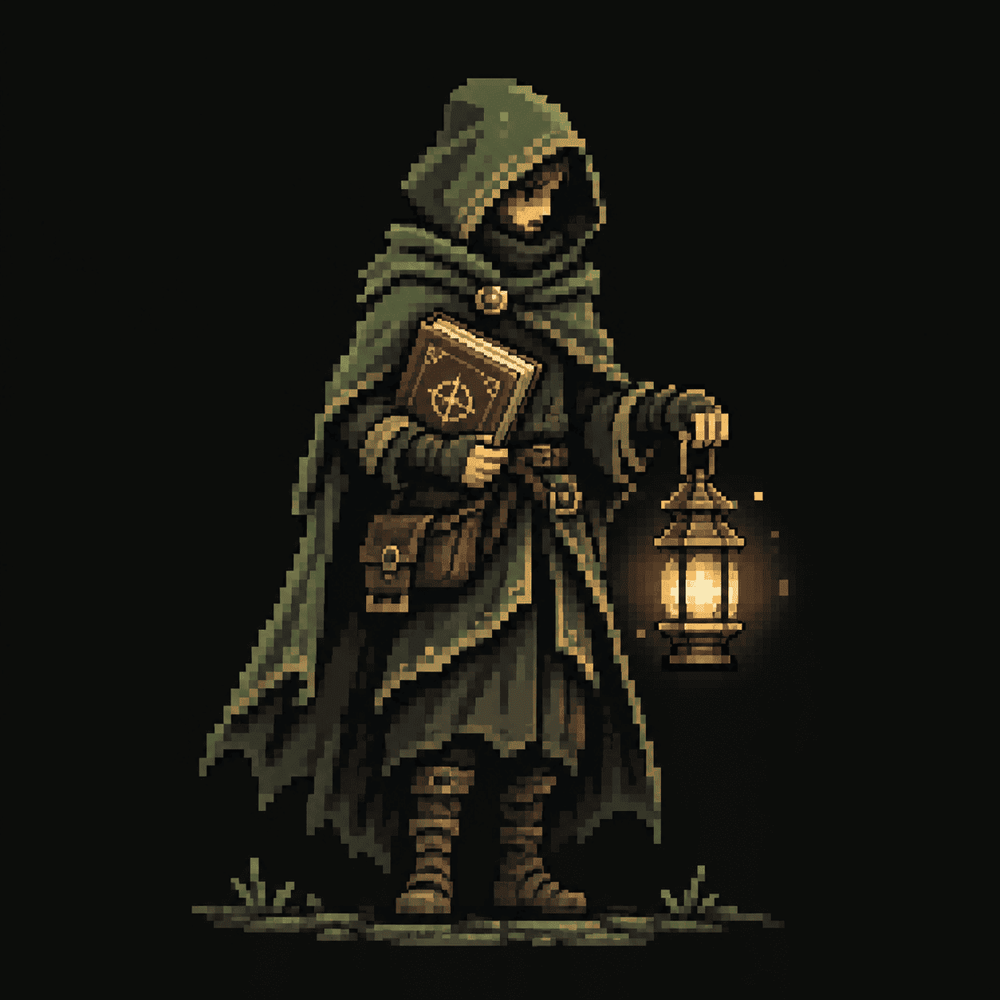

  

 

<table>
  <tr>
    <td width="160" align="center" valign="middle">
      
    </td>
    <td valign="middle">
      <h3>VELLBENEV</h3>
      
Builder · Independent Thinker · Technology Explorer

      
I build tools I wish existed, and leave them open for anyone else who needs them.

      <pre>◈ 0xVELL // QUIET ARCHITECT</pre>
    </td>
  </tr>
</table>

 

  

 

<h3>
   &nbsp;01 · WHY I BUILD
</h3>

Most software today asks you to rent your own digital life. Accounts get frozen, platforms change the rules, and your data sits on someone else's server.

I care about the opposite: software you actually own. Tools that run locally, respect privacy by default, and work without a middleman.

 

  

 

<h3>
   &nbsp;02 · WORK
</h3>

- **Unchain Foundation** — Peer-to-peer infrastructure for digital sovereignty and financial independence. Built around privacy-preserving architecture and zero-knowledge primitives.
- **[Nota](https://github.com/vellbenev/Nota)** — A quiet, distraction-free space for reading academic papers with local AI assistance. Everything stays on your machine. No cloud, no tracking.

 

  

 

<h3>
   &nbsp;03 · RESEARCH & CRAFT
</h3>

**Exploring**
Zero-Knowledge Proofs · Applied Cryptography · Local-First Software · P2P Systems

**Tools**
`TypeScript` · `React` · `Cryptography` · `Systems Design` · `Linux`

 

  

 

  <i>"Build what is missing. Keep it simple. Let people own their tools."</i>

