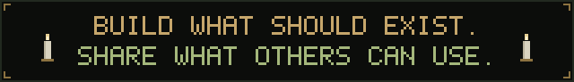

  
   
  
   
  Exploring technology for a more private, open and sovereign world.
   
  

<h3></h3>

Software should expand what a person can do on their own. It should not quietly rent them their own life.

| Value | In practice |
| :-- | :-- |
| **Ownership** | your keys, your files, your identity |
| **Privacy** | the default, not a setting |
| **Openness** | code anyone can read, fork and fix |
| **Autonomy** | fewer middlemen between you and what you made |

<h3></h3>

Tools I needed and could not find, so I built them.

| Project | What it is |
| :-- | :-- |
| **[Nota](https://github.com/vellbenev/Nota)** ★ | Read academic papers without distraction. Local-first, with on-demand local AI. |
| **[proxy-aggregator](https://github.com/vellbenev/proxy-aggregator)** | A directory of MTProto proxies, refreshed by an automated scraper. |
| **[TONForensics](https://github.com/vellbenev/TONForensics)** | On-chain intelligence for TON: profile wallets, trace token flows. |
| **[url-to-md](https://github.com/vellbenev/url-to-md)** | Paste a URL, get clean Markdown. |

Also: [Foundry Fit](https://github.com/vellbenev/Foundry-Fit) (30-minute calisthenics for people who sit all day) and [Cook Without Brain](https://github.com/vellbenev/cook-without-brain) (a Persian recipe matcher for what's in your pantry).

<h3></h3>

**Unchain Foundation**

Digital sovereignty, privacy-preserving systems, peer-to-peer infrastructure, zero-knowledge technology and individual ownership.

Two years and several iterations in. Still being built.

<h3></h3>

| Languages | Craft | Exploring |
| :-- | :-- | :-- |
| TypeScript JavaScript Python | React · Next.js Vite · Flask Local-first apps | ZK proofs Applied cryptography P2P systems |

<h3></h3>

Zero-Knowledge Proofs · Cryptography & Privacy Engineering · Blockchain & Decentralized Systems · Self-Sovereign Infrastructure · Open-source Software

<h3></h3>

  
   
  Every square is a day. Private work counts too.
    
  

